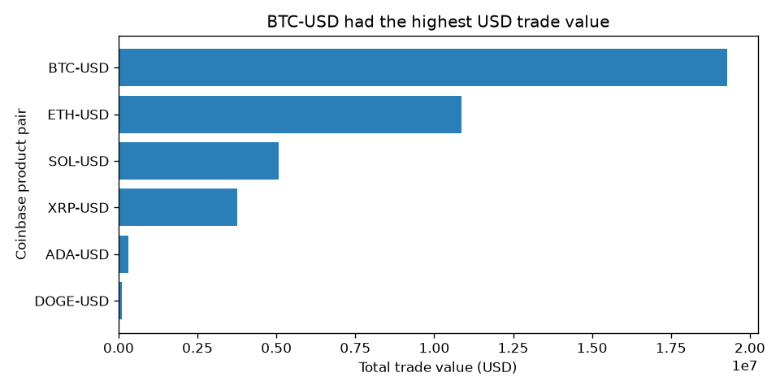

# Coinbase Trades: Comparing USD Trade Value Across Product Pairs

**Author:** Aimee Salazar Luna  
**DS 3022 Data Project 3, Fall 2026**

## Data source

I collected public Coinbase Exchange trade messages from `wss://ws-feed.exchange.coinbase.com` using a WebSocket, which pushes messages to the producer. I subscribed to the `matches` channel for six USD product pairs: BTC-USD, ETH-USD, SOL-USD, XRP-USD, ADA-USD, and DOGE-USD. A trade message includes the product pair, trade ID, side, size, price, sequence number, and event time. No account or API key is needed. The connection can send a subscription confirmation as well as trade messages, so the producer skips messages that do not contain trade fields.


## How to run


## How to run

After cloning the repository, open a terminal in the repository root, `ds3022-streaming`. Set up the environment and start Redpanda:

```bash
python3 -m venv .venv
source .venv/bin/activate
pip install -r requirements.txt
docker compose up -d
docker exec -it redpanda-0 rpk topic create coinbase_trades -p 3 -r 3
```

If the topic already exists on your cluster, skip the topic-creation command.

Open two more terminals in the repository root. In the first, start the producer:

```bash
cd project3
source ../.venv/bin/activate
python producer.py
```

In the second, start the lander:

```bash
cd project3
source ../.venv/bin/activate
python lander.py
```

For a short producer and lander check, leave them running until the lander writes a Parquet file. Stop the producer with Control+C, wait for the lander to finish its current batch, then stop the lander. To run the full-data flow, keep collecting until at least 50,000 raw records have landed. Raw data is not included in the repository, so a fresh clone must collect its own data before running that flow.

Open a third terminal in the repository root and start Prefect:

```bash
cd project3
source ../.venv/bin/activate
prefect config set PREFECT_API_URL=http://127.0.0.1:4200/api
prefect server start
```

Open a fourth terminal in the repository root and run the flow on the committed sample twice:

```bash
cd project3
source ../.venv/bin/activate
python flow.py data/sample
python flow.py data/sample
```

After collecting at least 50,000 raw records, run the full-data flow from that same terminal:

```bash
python flow.py
```

The sample is committed, so do not run `python kit/make_sample.py` when reproducing the README’s sample results. To rebuild the sample from your collected raw data, run that command and update the sample numbers in this README afterward.

## Architecture
producer.py → Kafka topic coinbase_trades → lander.py → raw Parquet files in data/raw/ → flow.py tasks (load_raw → stage → entities → marts → chart) → DuckDB tables, including mart_volume_by_product → charts/volume_by_product.png

Screenshots: [project evidence](docs/README.md).

## Design decisions

1. **Key and partitions.** I used `product_id` as the Kafka key and created three partitions. This keeps trades for each product pair in the same partition and preserves their order; using `trade_id` as the key would spread a pair’s trades across partitions and lose that ordering.

2. **Batch size and time.** The lander writes a batch at 1,000 records or after 60 seconds. My probe measured about 20.68 messages per second, which would fill 1,000 records in about 48 seconds; at that rate, the size limit would trigger first and make about 74 files per hour. During my actual capture, the rate varied, and many batches reached the 60-second limit before reaching 1,000 records.

3. **Offsets after the file.** The lander writes and renames the Parquet file before storing Kafka offsets. If it crashes between those steps, Kafka sends those messages again and the raw folder can contain duplicate records; I accept this at-least-once behavior because the flow removes duplicates later.

4. **Duplicates.** I identify the same Kafka record by its partition and offset, and the staging step keeps one copy of each. I identify the same Coinbase trade by `product_id` and `trade_id`; the entities step keeps one version of each trade.

5. **Windows and time.** I keep Coinbase’s `event_time` as the event-time column, but this chart does not use a time window. `mart_volume_by_product` compares total trade value across the full capture because my question asks which product pair had the highest overall total.

6. **Ten times the volume.** At ten times the volume, scanning all raw Parquet files again in the flow and rebuilding the chart could take longer, and the raw folder would grow faster. I would increase the batch size, organize raw files by date, and make the flow process new files incrementally.

## Chaos round

| Card | Prediction | What I did | Numbers before → after | Explanation |
|---|---|---|---|---|
| D1 Crash between file and offsets | I predict raw will increase by the new trades plus one repeated 1,000-record batch. Unique Kafka records and unique trades will increase only by the new trades because the crash happens after the file is written but before offsets are stored. | Ran `python producer.py` for about 2 minutes and stopped it; ran `python lander.py crash`, then restarted with `python lander.py`; ran `python four_numbers.py product_id,trade_id`. | Raw 52,446 → 57,472; malformed 0 → 0; unique Kafka records 52,446 → 56,472; unique product_id+trade_id 52,445 → 56,471 | The crash wrote a 1,000-record file but did not store offsets. The restart read and wrote those same records again. This is at-least-once delivery: raw contains the repeated batch, and the later flow can deduplicate it. |
| D2 Poison message | I predict raw and malformed will each increase by 1; unique Kafka records and unique trades will stay the same. | Ran `docker exec -it redpanda-0 rpk topic produce coinbase_trades -k bad`, typed `this is not JSON`, pressed Enter and Control+C, waited for the lander to print `Landed 1 records`, then ran `python four_numbers.py product_id,trade_id`. | Raw 57,472 → 57,473; malformed 0 → 1; unique Kafka records 56,472 → 56,472; unique product_id+trade_id 56,471 → 56,471 | The lander kept running and saved the invalid JSON as malformed instead of crashing. The bad message has no trade identity, so it does not change the unique record or trade counts. |
| D4 Source drops | I predict a brief network drop will pause the producer, which will reconnect when Wi-Fi returns. New records received after reconnect should not be duplicated. | Ran `python producer.py`, turned Wi-Fi off for 30 seconds and back on, stopped the producer after it reconnected, waited for the lander to write a file, then ran `python four_numbers.py product_id,trade_id`. | Raw 57,473 → 58,008; malformed 1 → 1; unique Kafka records 56,472 → 57,007; unique product_id+trade_id 56,471 → 57,006 | Raw, unique Kafka records, and unique trades each increased by 535; malformed stayed at 1. The reconnect added no duplicate rows. |


## The four numbers

From the flow log on the full data (screenshot in `docs/`):

| Number | Full data | Sample (`data/sample`) |
|---|---:|---:|
| Raw records landed | 58,022 | 5,000 |
| Malformed (kept in raw) | 1 | 0 |
| Unique Kafka records | 56,978 | 4,989 |
| Unique trades | 56,978 | 4,989 |

## Challenges / Obstacles
The Coinbase stream was uneven: my probe measured about 20.68 messages per second, but the rate varied during collection. During my reconnect test, the WebSocket closed and I also saw a temporary DNS error; the producer logged the problem, waited, and reconnected. I found a processing issue when my probe sample showed `last_match` but the stream records contained `match`, so the lander initially marked valid trades malformed. I inspected the raw JSON in Parquet, updated the lander to accept both types, and used a fresh consumer group to replay the topic. My chaos tests also showed why keeping raw data matters: the crash test produced duplicate landed records, which the flow removes, while the poison-message test stayed in raw as malformed without crashing the lander. For the analysis, I used DuckDB to sum `price * size` by product pair, then checked the results against the Prefect logs and chart. I used the probe, producer logs, Redpanda Console, Parquet, DuckDB, and Prefect to find and verify these issues.

## Analysis

Coinbase product pairs name the asset being traded against its pricing currency: BTC-USD means Bitcoin traded at a price in U.S. dollars; ETH-USD is Ether priced in dollars, and the other pairs are Solana (SOL), XRP, Cardano (ADA), and Dogecoin (DOGE), also priced in dollars. I summed each trade’s price multiplied by its size to compare total observed trade value by pair across my capture. BTC-USD was highest at $19.29 million, followed by ETH-USD at $10.85 million, SOL-USD at $5.08 million, and XRP-USD at $3.77 million. What surprised me was how concentrated the total was: BTC-USD was about 1.78 times ETH-USD and contributed nearly half of the roughly $39.40 million across all six pairs. This measures traded value, not profit or price growth. My results cover only six pairs during a limited live capture, and the Coinbase feed can drop messages without replay, so the totals may not include every trade or represent all Coinbase activity.

## Plot / Visualization



## Reflection
Before this project, I thought of Kafka mostly as a place where messages wait. I didn’t realize how many decisions happen after producing a message: the key sends it to a partition, offsets determine what gets read again, and a crash can create duplicates even when the original file was written. My D1 test made this click because the same batch appeared again after the lander restarted. I also learned to check a live source instead of assuming the probe told me everything. Coinbase’s real message type differed from the one I expected, and its WebSocket disconnected and reconnected. Keeping raw messages helped me investigate instead of lose data. Checking the landed files and rerunning Prefect helped me trust the results. If I started again, I’d inspect more real messages and test the producer-to-lander flow before collecting a large dataset. I’d also update my progress log as I finished each checkpoint.

## Acknowledgements

I used the course-provided `probe.py` and its Coinbase WebSocket example as a starting point for my producer. I used ChatGPT for guidance understanding the worksheet and streaming concepts, explaining errors, and suggesting code changes while also evaluating my README. I checked those suggestions by running the producer, lander, and Prefect flow; inspecting the raw Parquet records; checking the topic in Redpanda Console; and comparing the flow’s counts across repeated runs.

