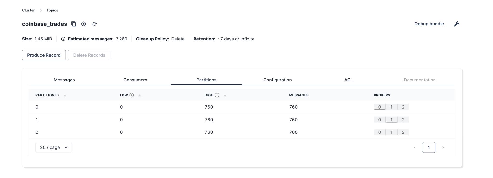
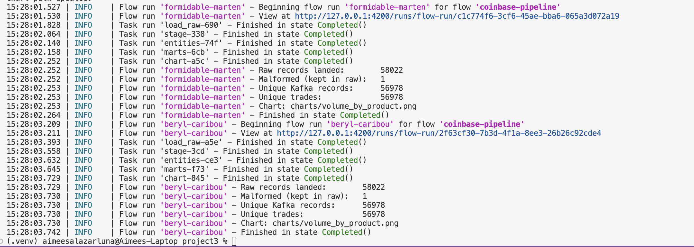
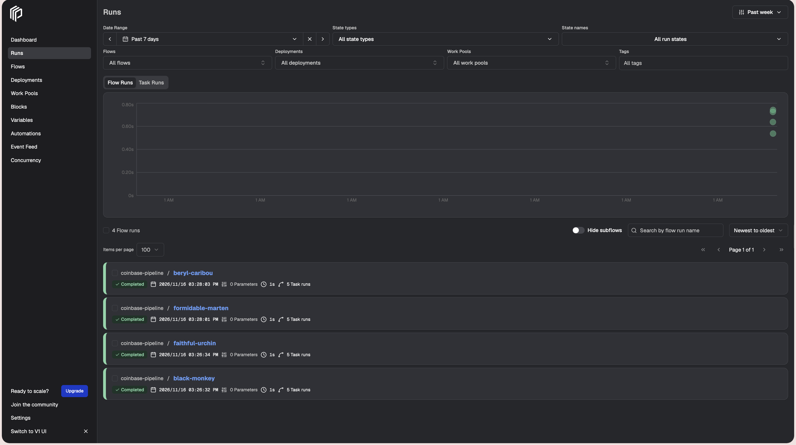

# docs/
# docs/

Evidence for the project. These screenshots are stored in this folder and document the required checkpoints.

## Checkpoint B: Kafka topic

Redpanda Console showing the `coinbase_trades` topic, its three partitions, and message counts.

## Checkpoint E: full-data flow

Terminal output showing the completed flow and its four numbers.

Prefect dashboard showing completed flow runs.

